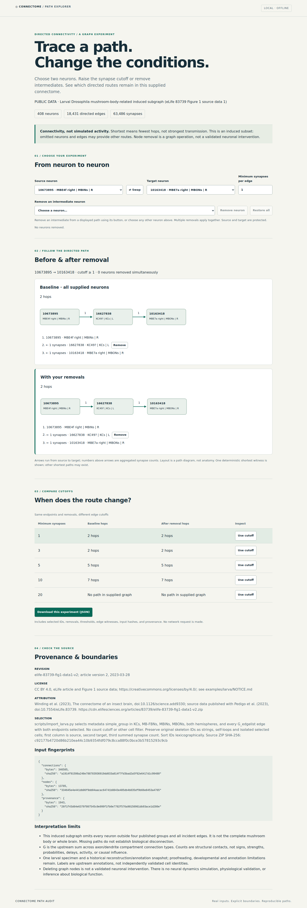

# Explore the real larval connectome subset

Open [`results/larva-demo/report.html`](../results/larva-demo/report.html) in a
browser. It is a self-contained interactive application: no server, installation,
account, or network access is required. If viewing the repository online, download
the file and open the local copy. The adjacent `report.json` contains the supplied
graph, and `COMPLETE.json` hashes both artifacts.



## A worked graph experiment

The demo starts at source `10673895` (MBE4f right, MBINs) and target `10163418`
(MBE7a right, MBONs). These are published labels, not new cell-type conclusions.

1. At cutoff **1**, the shortest directed path has **2 hops**. Counts gate each
   edge; they are not costs or a model of transmission strength.
2. Choose cutoff **5** in the comparison table. The shortest path now has **5 hops**.
3. Choose cutoff **10**. It has **7 hops**. Use the **Remove** button for neuron
   `5395823` on the path: a **9-hop** alternative remains.
4. **Restore all**, then remove `12871993`. There is **no path in this supplied
   graph** at cutoff 10. Restore it, then choose cutoff **20**: the baseline is
   already unreachable, a different result from removal-induced disconnection.
5. Select any of the 408 neurons as source or target, use **Swap** to test the
   reverse direction, and try other positive integer cutoffs. Remove more than
   one intermediate to test simultaneous graph deletions. Endpoints are protected;
   selecting a removed neuron as an endpoint restores it.
6. **Download this experiment** saves the current choices, baseline and changed
   paths, edge counts, comparison cutoffs, source hashes, provenance, and semantics.

Layout follows path order, not anatomy. Full labels and counts appear below each
path; long diagrams scroll horizontally. Controls work with a keyboard and on
narrow screens. Invalid cutoffs clear results and disable experiment downloads.

## Source and selection

This is an induced subgraph of the public larval *Drosophila* connectome published
by Winding et al. (2023), distributed with Pedigo et al. (2023), eLife 12:e83739,
Figure 1 source data 1. We retain the four source annotation groups `KCs`,
`MB-FBNs`, `MBINs`, and `MBONs` and all edges between them: **408 neurons, 18,431
directed edges, 63,486 synapses**. It is not the complete mushroom body or brain.

See [attribution, CC BY 4.0 terms, direction convention, and extraction details](../examples/larva/NOTICE.md)
and the [source manifest](../examples/larva/source-manifest.json). The original
1.3 MB source archive is included. Code uses the project's MIT license; biological
data retain their source license.

## Rebuild from the included public input

Python 3.10+ with the standard library is enough. Output directories must not
already exist, and their parents must exist.

```sh
python3 scripts/import_larva.py --check
PYTHONPATH=src python3 -m connectome_audit.explorer examples/larva/connections.csv \
  --nodes examples/larva/nodes.csv --provenance examples/larva/provenance.json \
  --source 10673895 --target 10163418 --output /tmp/larva-demo
```

Open `/tmp/larva-demo/report.html`. The explorer builder also accepts other files
following the existing CSV/provenance contract, up to 2,000 nodes and 50,000 edges.
The browser searches the embedded graph; it does not call a backend. IDs remain
strings. Shortest-path ties use Unicode code-point lexicographic order. A present
self-query has a zero-hop identity path. Every removal deletes the selected node
and all incoming and outgoing edges. Multiple selected removals apply together.
The baseline always uses the original graph at the current threshold.

For a precomputed Python audit with individual intermediate-removal evidence:

```sh
PYTHONPATH=src python3 -m connectome_audit examples/larva/connections.csv \
  --nodes examples/larva/nodes.csv --provenance examples/larva/provenance.json \
  --source 10673895 --target 10163418 --thresholds 1,3,5,10,20 \
  --single-node-failure --output /tmp/larva-audit
```

The checked-in [Python audit](../results/larva-audit/report.html) covers these
five thresholds and tests all 12 intermediate candidates on their baseline paths.
Each Python audit removal is an independent single-node trial; the interactive
explorer additionally supports simultaneous removals.

## Verify

Use the development environment described in the main README, including pinned
NetworkX and Playwright plus Chromium. Then run:

```sh
.venv/bin/python scripts/verify_larva.py
PYTHONPATH=src .venv/bin/python -m unittest discover -s tests
python3 scripts/check_tree.py
```

The real-data verifier checks extraction byte-for-byte and independently parses
the original ZIP into NetworkX, rather than trusting converted CSVs. It checks
all selected nodes, labels, directed edges, and counts, regenerates both shipped
bundles, verifies Python audit outcomes, and exercises the actual browser controls
and experiment download offline. NetworkX checks representative baseline and
removal distances and every reported edge, including reverse direction, identity,
unreachable, off-path removal, and simultaneous removal cases. Seed: `20261019`.
It also checks invalid cutoffs, endpoint protection, mobile layout, keyboard
activation, JavaScript errors, and attempted external requests. `--record` refreshes
only the real-data evidence and screenshot.

See [recorded real-data checks](../results/larva-verification.json). Earlier
synthetic verification artifacts remain historical evidence for the unchanged
Python auditing engine; they are not evidence of biological validity.

## Limits and existing work

The result answers a graph question: which supplied directed paths survive an
edge-count cutoff and graph deletion? It does not predict neural activity,
behavior, function, intervention outcomes, or consciousness. Missing neurons,
connections, reconstruction errors, compartment aggregation, developmental stage,
and upstream annotations can change every path. A no-path result applies only
to this supplied subgraph under the chosen conditions. An alternate route outside
the selected groups could reverse a disconnection finding.

The source paper already studies network structure and edge thresholds. CATMAID,
FlyWire Codex, and neuPrint provide existing connectome exploration workflows;
this project makes no novelty claim. Its contribution here is an account-free,
offline reproducible subset-to-interactive-path workflow with explicit source
fingerprints and separately checked removal evidence. See [existing work](existing-work.md).
Browser validation currently covers Linux Chromium, not all operating systems or
assistive technologies. The view draws path witnesses, not a full anatomical graph.
